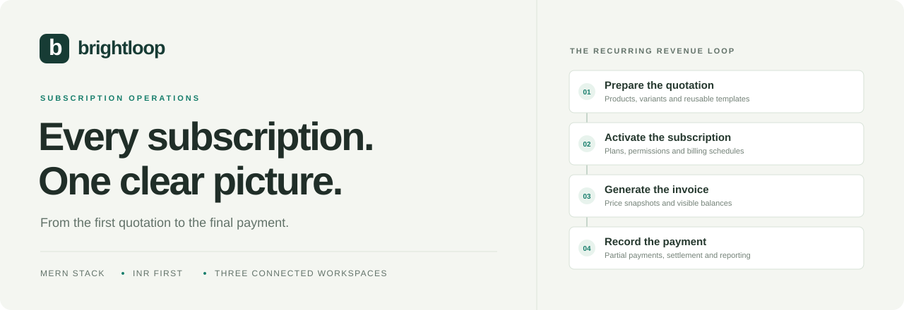
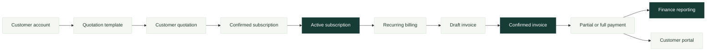
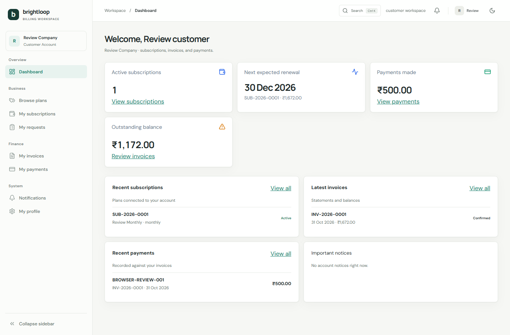
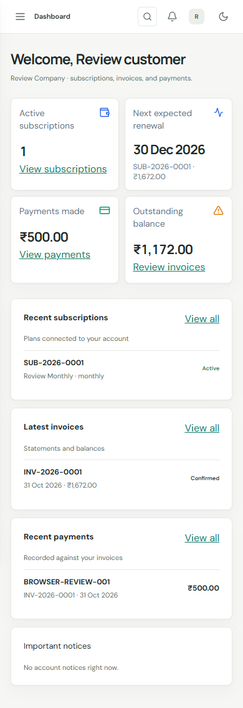
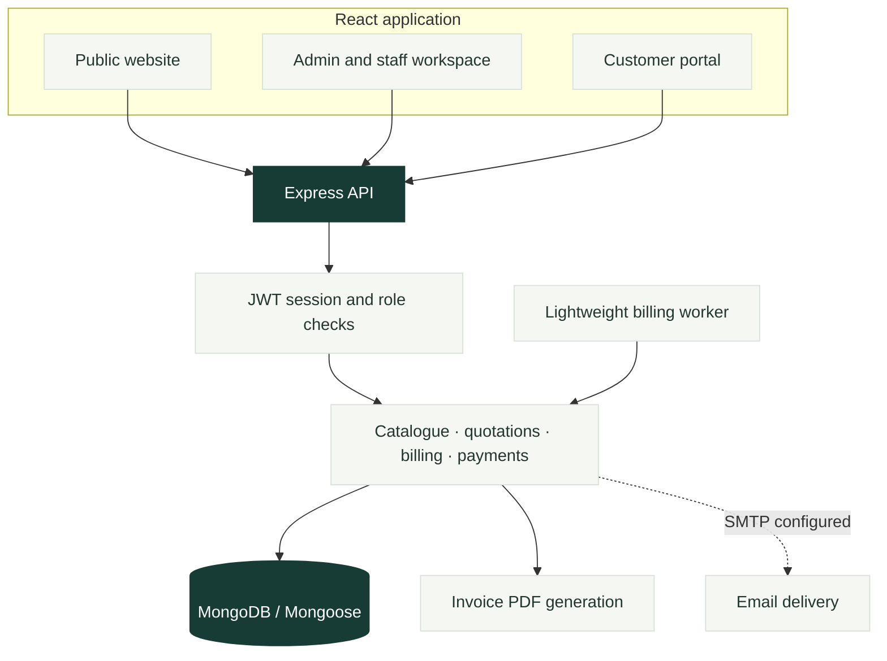

<!-- markdownlint-disable MD033 MD041 -->
<a id="top"></a>

<div align="center">



<h1>Brightloop</h1>

**The daily work behind recurring revenue. One connected workspace.**

Products. Quotations. Subscriptions. Invoices. Payments. A clearer view of the business.


[Explore the workflow](#how-brightloop-works) &nbsp; · &nbsp; [Run locally](#quick-start) &nbsp; · &nbsp; [Try a role](#choose-your-workspace) &nbsp; · &nbsp; [See the UI](#inside-the-product) &nbsp; · &nbsp; [Review the build](#verification-and-roadmap)

</div>

---

## The idea

A subscription business should be able to answer four questions without opening a spreadsheet:

**What is active? What was collected? What is still owed? What needs attention?**

Brightloop connects the records behind those answers. Administrators configure the catalogue, staff run billing operations, and customers see their own subscriptions and financial history. Dashboards read the database; invoices retain their price snapshots; partial payments retain a visible balance.

Built for an India-focused demo: **INR · Indian digit grouping · Asia/Kolkata · role-based workspaces.**

> **Build status:** working hackathon demo with tested workflows. Automatic discount re-evaluation, scoped tax-rule administration, and durable billing-run history remain incomplete. See [what comes next](#what-comes-next).

## How Brightloop works



**MRR describes recurring contracts. Collected revenue describes posted payments.** Brightloop keeps both visible without treating them as the same metric.

## Choose your workspace

Three roles share one product. Expand a role to see its demo login and what to explore.

<details open>
<summary><strong>01 · Admin — build the business workflow</strong></summary>

<br />

**Email:** `demo.admin@brightloop.test`<br />
**Password:** `Brightloop@Demo2026!`

Configure products, variants and plans; maintain quotation templates and discount rules; manage subscriptions, invoices, staff and workspace settings.

**Try this:** open a demo product, inspect its configurable variant extra, create a quotation from a multi-line template, then follow it through confirmation and activation.

</details>

<details>
<summary><strong>02 · Staff — run day-to-day operations</strong></summary>

<br />

**Email:** `demo.staff@brightloop.test`<br />
**Password:** `Brightloop@Demo2026!`

Work with customers, quotations, subscriptions, invoices, manual payments and reports. Catalogue writes and staff administration remain restricted to admins; product cost prices are excluded from staff responses.

**Try this:** open a confirmed invoice, record a partial payment, and inspect the remaining balance and payment history.

</details>

<details>
<summary><strong>03 · Customer — understand your account</strong></summary>

<br />

**Email:** `demo.customer@brightloop.test`<br />
**Password:** `Brightloop@Demo2026!`

View your own dashboard, subscriptions, invoices and payments; download invoice PDFs; update your profile; submit subscription-change or support requests.

**Try this:** download an invoice and compare its payment history with the balance shown in your portal.

</details>

These accounts are created by `npm run seed:sample`. They are development credentials. Set `BRIGHTLOOP_SAMPLE_PASSWORD` before the first seed to choose another password; reruns preserve existing account passwords.

## Inside the product

Actual application captures from the isolated browser-review dataset. The numbers are test records, not live business results.

<details open>
<summary><strong>Customer workspace · desktop</strong></summary>

<br />



</details>

<details>
<summary><strong>Customer workspace · mobile</strong></summary>

<br />



</details>

## What you can explore

| Area | Current experience |
| --- | --- |
| **Catalogue** | Products, editable variant groups, per-unit price extras, plans and billing frequencies |
| **Quotations** | Reusable templates, editable product lines, validity windows and server-calculated pricing |
| **Subscriptions** | Confirmation, activation, pause/close controls and plan-permission checks |
| **Recurring billing** | Due-date selection, chronological catch-up, duplicate-period protection and per-subscription failures |
| **Invoices** | Price snapshots, confirmation/cancellation rules, PDF downloads and optional SMTP delivery |
| **Payments** | Manual UPI, bank transfer, card, cheque, cash and other records; partial and full settlement |
| **Finance** | MRR, collected cash, outstanding balances, overdue records, monthly reports and CSV exports |
| **Operations** | Billing calendar, subscription health, activity records, derived notifications and global search |
| **Customer portal** | Owner-scoped records, invoice downloads, profile updates and change requests |
| **Interface** | Responsive navigation, light/dark theme, command palette, saved table views and reduced-motion support |

Selecting the seeded **Odoo** variant adds its configured **₹560 per unit**. Variant extras and tax rates remain configuration, rather than universal billing rules.

## Quick start

**You need:** Node.js **20+**, npm, and a running MongoDB server. The installed React Router and Playwright packages require Node 20 or newer.

### 1. Get the project

```bash
git clone https://github.com/ParthPatel9696/hackathon_subscription.git
cd hackathon_subscription
npm ci
npm ci --prefix client
```

### 2. Configure the API

<details open>
<summary><strong>Windows · PowerShell</strong></summary>

```powershell
Copy-Item .env.example .env
```

</details>

<details>
<summary><strong>macOS / Linux · shell</strong></summary>

```bash
cp .env.example .env
```

</details>

Edit `.env`:

```dotenv
PORT=5000
MONGODB_URI=mongodb://127.0.0.1:27017/brightloop_subscriptions
CLIENT_ORIGIN=http://localhost:5173
JWT_SECRET=replace-with-your-generated-secret
BILLING_WORKER_INTERVAL_MINUTES=15
```

Generate a secret, then paste it into `JWT_SECRET`:

```bash
node -e "console.log(require('node:crypto').randomBytes(32).toString('hex'))"
```

Keep `.env` private. The signing secret must be at least 32 characters.

### 3. Add the demo dataset

```bash
npm run seed:sample
```

This seed **adds linked sample records without clearing existing business data**. Stable identities make it safe to rerun, and existing passwords/settings are preserved. Sample seeding is disabled in production.

### 4. Start the three processes

Run each command in a separate terminal, from the repository root:

| Terminal | Command | Purpose |
| --- | --- | --- |
| **API** | `npm run dev` | Express API on port `5000` |
| **Frontend** | `npm run dev --prefix client` | React application on port `5173` |
| **Worker** | `npm run billing:worker` | Recurring billing and scheduled maintenance |

**Open [localhost:5173](http://localhost:5173)** and choose a demo account above.

The worker checks every 15 minutes by default. The UI also supports manual billing runs; forcing not-yet-due subscriptions is admin-only.

<details>
<summary><strong>Configuration notes · API URL, email and older databases</strong></summary>

- **Separate API host:** set `VITE_API_URL` in `client/.env.local`, for example `http://localhost:5000/api`. Allow the browser origin in the API's `CLIENT_ORIGIN` setting.
- **Sessions:** authentication uses an HTTP-only cookie. Customer ownership and role permissions are enforced by the API.
- **Email:** set `SMTP_HOST`, `SMTP_PORT`, `SMTP_SECURE`, `SMTP_USER`, `SMTP_PASSWORD` and `SMTP_FROM` to enable reset/invoice delivery. Without SMTP, development can return a simulated reset link; production does not expose it. PDF downloads work without SMTP.
- **Older database index:** if new subscriptions fail with a duplicate `scheduledPlanChange.operationKey: null`, run `npm run db:repair-indexes`. The repair validates the corrected index before replacing the legacy index, without editing subscription documents.

</details>

## A demo with a story

Use this suggested walkthrough when presenting to judges:

1. **Start with the business question.** Open the admin dashboard: active subscriptions, collections and outstanding balances come from stored records.
2. **Show the pricing detail.** Open a product and its variant editor. Explain how a configured extra changes the relevant line price.
3. **Build the offer.** Choose a quotation template, adjust its product quantities, and create a customer quotation.
4. **Activate the relationship.** Confirm and activate the subscription through its detail-page actions.
5. **Follow the invoice.** Generate a due invoice, or deliberately use admin force mode for a demo subscription whose date has not arrived. Confirm the draft invoice.
6. **Make payment visible.** Record a partial payment, show the balance, then record the remainder and verify the invoice becomes Paid.
7. **Change perspective.** Sign in as that customer and show the same subscription, invoice PDF and payment history in the customer portal.

**The point to demonstrate:** the same records connect the business workflow and the customer's account.

<details>
<summary><strong>What's in the sample database?</strong></summary>

<br />

| Sample records | Count |
| --- | ---: |
| Admin / staff / customer accounts | 1 / 2 / 12 |
| Products with variants | 6 |
| Plans across daily, weekly, monthly and yearly billing | 8 |
| Discount rules / quotation templates | 3 / 3 |
| Subscriptions | 16 |
| Invoices | 51 |
| Linked payments | 46 |
| Internal notes / customer requests / activity events | 12 / 3 / 16 |

All **13 current collections** are populated, including workspace settings and identifier counters. Existing settings are retained. Invoice samples include paid, partial, overdue, draft and cancelled records. Tax rates are illustrative settings.

The dataset is defined in [the sample seed](seeds/seed-sample.js). Collection totals can be larger when a database already contains records.

</details>

## Under the hood



| Layer | Stack |
| --- | --- |
| **Interface** | React 18 · Vite · JavaScript · Tailwind CSS · Lucide |
| **Navigation and state** | React Router · Zustand · TanStack Query · Axios |
| **Charts and motion** | Recharts · Motion for React |
| **API and data** | Node.js · Express · MongoDB · Mongoose |
| **Identity and documents** | JWT · bcryptjs · PDFKit · Nodemailer |
| **Verification** | Node test runner · Playwright · headless Edge |

<details>
<summary><strong>Engineering details worth opening</strong></summary>

<br />

- **Money:** new financial paths use integer paise for calculation. Compatible rupee fields remain available; historical records are not bulk-converted.
- **Price snapshots:** invoice lines retain the prices used when billed. Editing a product does not rewrite old invoices.
- **Payments:** invoice-linked manual entries support partial/full settlement, balance guards and duplicate-reference protection. A manually entered reference is not gateway verification.
- **Recovery:** transaction-capable MongoDB deployments use transaction paths. Standalone deployments use recoverable billing schedule writes and a pending-payment journal.
- **Billing:** a unique subscription/period business key protects repeat runs. Failed subscriptions are reported independently so processing can continue.
- **Localization:** display uses `en-IN` and `Asia/Kolkata`. PDFs use readable `INR` text with Indian digit grouping.
- **Access:** customers are scoped to their own records. Product cost prices are excluded from non-admin catalogue responses.
- **Interaction:** `Ctrl+K` / `⌘K` opens the command palette. Tables support filtering, sorting, visibility preferences, saved views and CSV exports; saved preferences are local to the browser.

</details>

<details>
<summary><strong>Repository map</strong></summary>

```text
brightloop/
├── client/
│   ├── src/components/    Shared UI, forms and navigation
│   ├── src/pages/         Public and authenticated experiences
│   ├── src/utils/         Currency and date presentation
│   └── e2e/               Browser workflow checks
├── controllers/           HTTP request handlers
├── middleware/            Authentication, permissions and validation
├── models/                Mongoose schemas and indexes
├── routes/                API routing
├── services/              Billing, pricing helpers, PDFs and email
├── workers/               Recurring billing scheduler
├── seeds/                 Demo accounts and linked sample records
├── scripts/               Database maintenance utilities
├── test/                  Unit and API integration checks
└── docs/assets/           README cover and product screenshots
```

</details>

## Verification and roadmap

Last recorded engineering review: **31 October 2026**. These are results from that review, not a live CI status badge.

| Check | Recorded result |
| --- | --- |
| Backend suite, including isolated MongoDB integration | **23 passed** |
| Browser suite | **11 passed** |
| Route coverage | **150 visits** across public/admin/staff/customer experiences |
| Viewports checked | **1366 px desktop · 390 px mobile** |
| Client production build | **Passed** |
| Sample data | **Preservation, idempotency and payment reconciliation verified** |

Explore the [backend regression checks](test/api.integration.test.js) and [browser workflow checks](client/e2e/product-review.spec.js) for the behavior covered.

<details>
<summary><strong>Run unit checks and the production build</strong></summary>

```bash
npm test
npm run build --prefix client
```

Without `BRIGHTLOOP_INTEGRATION_DB`, the unit checks run and the database integration test is skipped.

</details>

<details>
<summary><strong>Run API integration checks · PowerShell</strong></summary>

Use a dedicated disposable database on your local MongoDB server. This test drops its target database and requires a local name ending in `_test`.

```powershell
$env:BRIGHTLOOP_INTEGRATION_DB='mongodb://127.0.0.1:27017/brightloop_test'
npm test
Remove-Item Env:BRIGHTLOOP_INTEGRATION_DB
```

</details>

<details>
<summary><strong>Run browser checks · PowerShell + installed Edge</strong></summary>

Use a running local MongoDB server and a dedicated disposable database. The test runner owns its API/frontend servers on ports `5019` and `5179` and replaces the explicitly named browser test database.

```powershell
$env:BRIGHTLOOP_BROWSER_DB='mongodb://127.0.0.1:27017/brightloop_browser_test'
$env:BRIGHTLOOP_BROWSER_EXECUTABLE='C:\Program Files (x86)\Microsoft\Edge\Application\msedge.exe'
npm run test:e2e --prefix client
Remove-Item Env:BRIGHTLOOP_BROWSER_DB
Remove-Item Env:BRIGHTLOOP_BROWSER_EXECUTABLE
```

On another operating system, set a compatible Chromium executable, or install Playwright's Chromium from `client` with `npx playwright install chromium` and omit `BRIGHTLOOP_BROWSER_EXECUTABLE`.

The suite covers public pages, role guards, mobile layouts, editable template quotations, payments, CSV downloads, dialog focus, registration and account switching.

</details>

### What comes next

- [ ] Re-evaluate discount eligibility on each recurring invoice and count usage at confirmation.
- [ ] Add dated product/category tax rules and their administration screen.
- [ ] Persist billing runs, attempts, retries and reminder history.
- [ ] Complete active-term renewal and reconcile lifecycle behavior with the original brief.
- [ ] Extend report filters, quotation revisions, notification preferences and support workflows.
- [ ] Validate the 10,000-subscription / 50,000-invoice performance targets.

SMTP delivery and replica-set transaction behavior need environment-specific verification. Public pricing, contact details and legal notices require operator configuration. Notification preferences, a complete support workflow and cross-device table preferences also remain open.

<details>
<summary><strong>Other seed commands · understand their scope</strong></summary>

| Command | Behavior |
| --- | --- |
| `npm run seed:sample` | Adds the linked sample dataset; preserves existing business records and passwords |
| `npm run seed:demo` | Creates or refreshes the older three demo accounts, resets their development passwords and revokes their previous sessions |
| `npm run seed` | **Deletes and recreates application records**; use only on a disposable database |

The older `seed:demo` account set is:

| Role | Email | Password |
| --- | --- | --- |
| Admin | `admin@brightloop.com` | `Admin@Secure2024!` |
| Staff | `jordan.lee@brightloop.com` | `Staff@Secure2024!` |
| Customer | `finance@acmeretail.com` | `Acme@Customer2024!` |

Use the sample accounts near the top of this README for the linked hackathon dataset.

</details>

## Go deeper

| Document | Open it for |
| --- | --- |
| [API route map](routes/api.js) | Endpoints, role checks and request middleware |
| [Application route map](client/src/App.jsx) | Public and authenticated pages |
| [Billing service](services/billingService.js) | Recurring runs, catch-up and recovery paths |
| [Money utilities](utils/money.js) | Integer paise arithmetic and INR formatting |
| [Browser checks](client/e2e/product-review.spec.js) | Role-specific pages and customer workflows |

---

<div align="center">

**brightloop**<br />
Every subscription. Every invoice. One clear picture.

[Back to top](#top)

</div>
