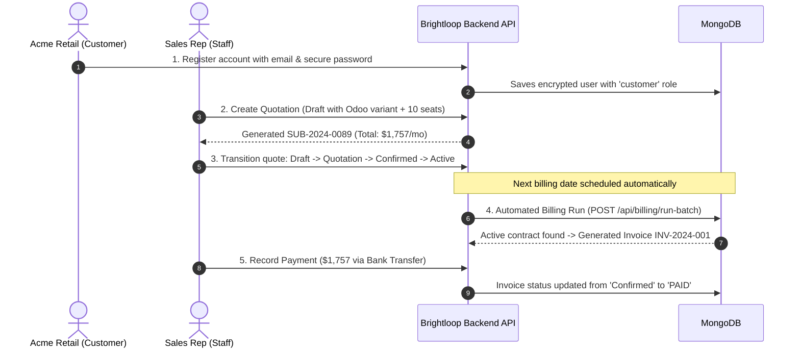

# 🚀 Brightloop - Subscription Management & Recurring Billing System

A complete, production-ready backend API built with **Node.js**, **Express**, and **MongoDB (Mongoose)** for managing software subscriptions, multi-variant products, automated recurring billing cycles, and payment reconciliation.

Designed and developed for the **Odoo Hackathon Challenge**.

---

## 📖 What is this Project? (In Simple Words)

Imagine a company like **Netflix, Spotify, or an ERP software provider** that sells products on a recurring monthly or yearly basis. Tracking renewals on spreadsheets leads to missed payments, wrong invoices, and chaos.

This backend serves as the **digital backbone** for a subscription business:
1. **User Accounts & Roles:** Customers sign up, staff create quotes, and admins control the entire system.
2. **Contract Lifecycle:** Subscriptions follow a strict state machine: `Draft ➔ Quotation ➔ Confirmed ➔ Active ➔ Closed`.
3. **Automated Billing Day:** When bills are due, it automatically generates accurate invoices with calculated taxes and discounts, **guaranteeing no duplicate billing**.
4. **Payment Recording:** Staff records incoming payments (Bank Wire, Credit Card, UPI, Check) against invoices to mark them **Paid**.
5. **Finance Metrics:** Delivers real-time Monthly Recurring Revenue (MRR), active contract counts, and overdue debts in under **150 milliseconds** (well within the `< 2s` requirement).

---

## 🛠️ Tech Stack

* **Runtime:** Node.js (v18+)
* **Framework:** Express.js
* **Database:** MongoDB with Mongoose ODM
* **Security & Auth:** JSON Web Tokens (JWT) & bcrypt password hashing
* **Architecture:** Modular MVC (Models, Controllers, Routes, Middleware)
* **Frontend:** React, Vite, Tailwind CSS, React Router, Zustand, Axios, TanStack Query, Lucide React, Recharts

---

## 🔄 Real-Time Workflow Example (How It Works)

Here is a real-world scenario from start to finish:

### Scenario:
A customer (**Acme Retail**) signs up, requests an **ERP software plan with an Odoo Brand variant (+ $60)** and **10 User Seats**, gets an automated invoice on billing day, and pays via Bank Wire.



---

## ⚡ Quick API Examples

### 1. Customer Registration (Strict Password Rule)
Customers can register, but the password **must** be more than 8 characters, contain an uppercase letter, a lowercase letter, and a special character:

```bash
POST /api/auth/register
Content-Type: application/json

{
  "name": "Sarah Jenkins",
  "companyName": "Acme Retail Corp",
  "email": "finance@acmeretail.com",
  "password": "Acme@Customer2024!"
}
```

**Response (201 Created):**
```json
{
  "success": true,
  "message": "Account created successfully! Welcome to Brightloop.",
  "token": "eyJhbGciOiJIUzI1NiIsInR5cCI6IkpXVCJ9...",
  "user": {
    "id": "66321f8a84c8a2b5e4c89111",
    "name": "Sarah Jenkins",
    "email": "finance@acmeretail.com",
    "role": "customer"
  }
}
```

---

### 2. Creating a Subscription with Brand Variant Markup
Selecting the **Odoo Brand** variant automatically adds `+$60.00` to the product line:

```bash
POST /api/subscriptions
Content-Type: application/json

{
  "customerId": "66321f8a84c8a2b5e4c89111",
  "customerName": "Apex Global Corp",
  "customerEmail": "billing@apexcorp.com",
  "planName": "Enterprise Cloud Suite",
  "billingFrequency": "monthly",
  "paymentTerms": "Net 30 Days",
  "lines": [
    {
      "productName": "Brightloop Core ERP",
      "variantName": "Odoo Brand Edition (+ $60.00)",
      "variantPriceExtra": 60,
      "quantity": 1,
      "unitPrice": 1500,
      "taxRate": 0.10
    },
    {
      "productName": "Additional User Seats",
      "quantity": 10,
      "unitPrice": 25,
      "taxRate": 0.10
    }
  ]
}
```

**Response (201 Created):**
```json
{
  "success": true,
  "data": {
    "subscriptionNumber": "SUB-2024-0089",
    "status": "Draft",
    "subtotal": 1810.00,
    "taxTotal": 181.00,
    "recurringTotal": 1757.00
  }
}
```

---

### 3. State Machine Transition (Lifecycle Validation)
Transitions enforce the business rules: `Draft ➔ Quotation ➔ Confirmed ➔ Active ➔ Closed` (or `Paused`).

```bash
POST /api/subscriptions/transition
Content-Type: application/json

{
  "id": "66321f8a84c8a2b5e4c89111",
  "targetStatus": "Confirmed",
  "reason": "Customer accepted the quotation terms."
}
```

> **Illegal Jump Protection:** Attempting an illegal jump (like jumping directly from `Draft` to `Closed`) will return `400 Bad Request` with an explanatory error.

---

### 4. Running the Recurring Billing Engine
Billing automatically processes all active subscriptions due for renewal:

```bash
POST /api/billing/run-batch
Content-Type: application/json

{
  "forceAllActive": false
}
```

**Response:**
```json
{
  "success": true,
  "message": "Batch completed: 1 invoices generated.",
  "generatedCount": 1,
  "skippedCount": 0
}
```

---

### 5. Recording Payment Against an Invoice
Record payment method, amount, date, and transaction reference note to reconcile:

```bash
POST /api/payments
Content-Type: application/json

{
  "invoiceId": "66321f8a84c8a2b5e4c89222",
  "amount": 1757.00,
  "method": "Bank Transfer",
  "referenceNote": "Bank Wire Txn #WIRE-98218-NY"
}
```

**Response:**
```json
{
  "success": true,
  "message": "Payment of $1757 recorded for invoice INV-2024-001. Status: Paid"
}
```

---

## 📂 Project Structure

```
server/
├── config/
│   └── db.js                 # MongoDB connection using Mongoose
├── controllers/
│   ├── authController.js     # User registration, login, JWT & staff creation
│   ├── subscriptionController.js # Lifecycle state machine transitions & lines
│   ├── billingController.js  # Recurring billing engine with duplicate prevention
│   ├── paymentController.js  # Payment recording & invoice reconciliation
│   ├── dashboardController.js # High-speed financial metrics (< 2s SLA)
│   ├── discountController.js # Promo rules with expiration & usage caps
│   └── seedController.js     # 1-Click database seeder for demo scenarios
├── middleware/
│   └── auth.js               # JWT verification & Role-Based Access Control (RBAC)
├── models/
│   ├── User.js               # User accounts with bcrypt hashing
│   ├── Product.js            # Products with variant markups (e.g. Odoo brand)
│   ├── Plan.js               # Plan billing cadences & rules
│   ├── Subscription.js       # Subscription state machine & line items
│   ├── Invoice.js            # Recurring invoice records
│   ├── Payment.js            # Payment records
│   └── Discount.js           # Admin-only discount engine
├── routes/
│   └── api.js                # Express API router
├── .env.example              # Environment variables template
├── .gitignore                # Ignored node_modules and environment secrets
├── index.js                  # Server entry point
└── package.json
```

---

## 🚀 Getting Started Locally

### 1. Prerequisites
- **Node.js** (v18 or higher)
- **MongoDB** running locally on port `27017` (or MongoDB Atlas connection string)

### 2. Installation
Navigate into the `server` directory and install dependencies:

```bash
cd server
npm install
```

### 3. Environment Variables
Create a `.env` file in the `server` directory:

```env
PORT=5000
MONGODB_URI=mongodb://127.0.0.1:27017/brightloop_subscriptions
JWT_SECRET=replace-with-a-long-random-secret
CLIENT_ORIGIN=http://localhost:5173
```

### 4. Seed Initial Hackathon Data
Populate realistic products, plans, subscriptions in all 5 states, invoices, and coupons:

```bash
npm run seed
# or make a GET request to http://localhost:5000/api/seed
```

### 5. Start the Server
```bash
# Production mode:
npm start

# Development mode (with auto-reload):
npm run dev
```

Server runs on: **`http://localhost:5000`**  
API Base: **`http://localhost:5000/api`**

### 6. Start the React client

```bash
cd client
npm install
npm run dev
```

The client runs on **`http://localhost:5173`** and uses `VITE_API_URL` when provided;
otherwise it connects to `http://localhost:5000/api`.

### Frontend business workflows

The client now provides interactive operations for the backend workflows that have
corresponding API endpoints:

- Search, status filtering, refresh, and CSV export on resource tables.
- Create quotations from available plans and products.
- Transition subscriptions through valid lifecycle states only.
- Record full or partial invoice payments with supported payment methods.
- Create and validate discount definitions through the API.
- Run the recurring billing batch from the invoice workspace.

Customer, product, plan editing, invoice PDF generation, and report-specific
date-range APIs are not exposed by the current backend routes, so those actions
remain read-only until their server endpoints are added.

## 🧭 Current architecture and security boundaries

The backend preserves the original endpoint paths while using the following flow:

```
Routes → Middleware → Controllers → Services → Models → MongoDB
```

Financial endpoints require authentication. Admins manage staff, discounts, and forced
billing; staff manage operational billing; customers are restricted to their own
subscriptions, invoices, and payment history. The seed endpoint is admin-only because
it deletes and recreates all application data.

The client provides role-aware layouts for administrator, staff, and customer portals.
The browser uses an HTTP-only, SameSite session cookie for API authentication; Bearer
tokens remain accepted for existing API clients. JWT logout clears the cookie. A token
blacklist/session store can be added if immediate server-side revocation across already
issued tokens is required.

## 💰 Financial calculation methodology

All new calculations use integer minor currency units (cents) internally:

* **Line subtotal:** `(unit price + variant adjustment) × quantity`
* **Tax:** `line subtotal × tax rate`, rounded to the nearest minor unit
* **Line total:** `subtotal + tax - discount`
* **Outstanding balance:** `max(0, invoice total - paid amount)`
* **Collected revenue:** paid invoice amounts only; unpaid and partially unpaid invoices
  are never counted as collected revenue
* **MRR:** active monthly totals, with weekly and daily totals normalized to a month and
  yearly totals divided by 12

Legacy decimal fields remain in the schemas for API compatibility, while new records
also persist their minor-unit equivalents. Invoice line and customer fields are copied
onto each invoice so later catalog or customer changes do not rewrite historical invoices.

## 🧪 Validation

Run backend unit tests with:

```bash
npm test
```

Run the frontend production build with:

```bash
cd client
npm run build
```

The repository includes deterministic unit coverage for minor-unit calculations and
billing cadence. Full authentication, MongoDB integration, and browser workflow tests
require a running MongoDB instance and are not represented by fabricated results.

---

## 📋 API Route Reference

| Method | Endpoint | Access | Description |
| :--- | :--- | :--- | :--- |
| `POST` | `/api/auth/register` | Public | Register customer (validates strict password criteria) |
| `POST` | `/api/auth/login` | Public | Sign in and receive JWT token |
| `GET` | `/api/auth/me` | Authenticated | Get current user profile |
| `POST` | `/api/auth/forgot-password` | Public | Generate simulated password reset link |
| `POST` | `/api/auth/add-staff` | **Admin Only** | Provision a new internal staff member |
| `GET` | `/api/dashboard/metrics` | Public | Executive MRR, active subs, overdue tally (< 2s) |
| `GET` | `/api/subscriptions` | Public | List all subscriptions (with status filter) |
| `POST` | `/api/subscriptions` | Public | Create new subscription / quotation |
| `POST` | `/api/subscriptions/transition` | Public | Transition lifecycle state (`Draft` ➔ `Quotation` ➔ `Confirmed` ➔ `Active` ➔ `Closed`) |
| `POST` | `/api/billing/run-batch` | Public | Trigger automated recurring invoice generation |
| `GET` | `/api/invoices` | Public | List invoices (`Draft`, `Confirmed`, `Paid`, `Overdue`) |
| `POST` | `/api/payments` | Public | Record payment against invoice |
| `GET` | `/api/discounts` | Public | List active discount campaigns |
| `POST` | `/api/discounts` | **Admin Only** | Create percentage or fixed discount rule |
| `POST` | `/api/discounts/validate` | Public | Validate coupon code against cart |
| `GET` | `/api/seed` | Public | Reset database with complete demo scenario |

---

## 📄 License
MIT License. Built for the Odoo Hackathon.
